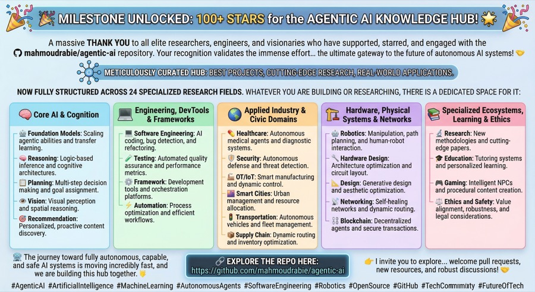

# Agentic AI Research Radar

**300+ curated agentic AI papers, benchmarks, frameworks, and real-world systems across 24 domains.**

[Start with Frameworks](README-framework.md) | [Explore Security](README-security.md) | [Browse Research](README-research.md) | [Contribute a Resource](CONTRIBUTING.md)

## Why This Repo

Agentic AI moves fast, and useful work is scattered across papers, code repositories, benchmark releases, technical posts, and domain-specific case studies. This repo tracks high-signal work in one place so builders and researchers can quickly find:

- frameworks and orchestration patterns for building agents
- evaluation, testing, and benchmark resources
- security, safety, and governance research
- domain applications in healthcare, Physical AI/robotics, software engineering, IoT, education, and more

If this saves you research time, starring the repo helps more builders discover it.

## Suggested Paths

| Path | Follow these domains |
| --- | --- |
| Core AI & Cognition | [Foundation Models](README-foundation-models.md), [Reasoning](README-reasoning.md), [Planning](README-planning.md), [Vision](README-vision.md), [Recommendation](README-recommendation.md) |
| Engineering, DevTools & Frameworks | [Software Engineering](README-software-engineering.md), [Testing](README-testing.md), [Framework](README-framework.md), [Automation](README-automation.md) |
| Applied Industry & Civic Domains | [Healthcare](README-healthcare.md), [Security](README-security.md), [OT/IoT](README-iot.md), [Smart Cities](README-smart-cities.md), [Transportation](README-transportation.md), [Supply Chain](README-supply-chain.md) |
| Hardware, Physical Systems & Networks | [Physical AI/Robotics](README-robotics.md), [Hardware Design](README-hardware-design.md), [Design](README-design.md), [Networking](README-networking.md), [Blockchain](README-blockchain.md) |
| Specialized Ecosystems, Learning & Ethics | [Research](README-research.md), [Education](README-education.md), [Gaming](README-gaming.md), [Ethics and Safety](README-ethics-and-safety.md) |

## Domain Index

| Domain | Researches | Focus |
| --- | ---: | --- |
| [🔬 Research](README-research.md) | 67 | AI scientists, deep research, autonomous discovery |
| [⚙️ Framework](README-framework.md) | 65 | Agent runtimes, memory, tools, orchestration |
| [🛡️ Security](README-security.md) | 55 | Prompt injection, red teaming, cyber agents, defenses |
| [🧠 Reasoning](README-reasoning.md) | 26 | Inference, deliberation, cognitive architectures |
| [🧪 Testing](README-testing.md) | 27 | Benchmarks, harnesses, evaluation methodology |
| [💊 Healthcare](README-healthcare.md) | 16 | Medical agents, diagnosis, pharma, biomedical research |
| [💻 Software Engineering](README-software-engineering.md) | 16 | Coding agents, debugging, refactoring, code review |
| [⚡ Automation](README-automation.md) | 15 | Process automation and workflow optimization |
| [📡 Networking](README-networking.md) | 9 | Self-healing networks and routing |
| [👁️ Vision](README-vision.md) | 9 | Visual agents and multimodal grounding |
| [🤖 Physical AI/Robotics](README-robotics.md) | 8 | Physical AI, embodied agents, and robot systems |
| [🤖 Foundation Models](README-foundation-models.md) | 8 | Agentic capabilities in foundation models |
| [🔧 Hardware Design](README-hardware-design.md) | 6 | EDA, chip design, verification |
| [⚖️ Ethics and Safety](README-ethics-and-safety.md) | 6 | Alignment, fairness, trust, governance |
| [🏭 OT/IoT](README-iot.md) | 6 | Industrial systems and device control |
| [🎯 Recommendation](README-recommendation.md) | 5 | Personalization and proactive discovery |
| [🌆 Smart Cities](README-smart-cities.md) | 5 | Urban operations and civic systems |
| [⛓️ Blockchain](README-blockchain.md) | 4 | Decentralized agents and secure transactions |
| [🎮 Gaming](README-gaming.md) | 4 | NPCs, simulation, procedural content |
| [📐 Design](README-design.md) | 3 | Generative and collaborative design |
| [🚦 Transportation](README-transportation.md) | 2 | Autonomous vehicles and fleet management |
| [📋 Planning](README-planning.md) | 2 | Multi-step decision making and goal assignment |
| [🎓 Education](README-education.md) | 1 | Tutoring and personalized learning |
| [📦 Supply Chain](README-supply-chain.md) | 1 | Routing, inventory, logistics optimization |

## Papers by Company and Institution

Counts use the recorded affiliations in all section tables: one count per unique paper/source for each organisation, consolidating aliases and departments/research divisions. Cross-section duplicates count once; independent and unverified affiliations are excluded. Ties are alphabetical.

| Company/Institution | Section Names | Count |
| --- | --- | ---: |
| Stanford University | [Ethics and Safety], [Framework], [Gaming], [Healthcare], [Planning], [Reasoning], [Research], [Security], [Software Engineering], [Testing] | 27 |
| Google | [Automation], [Framework], [Healthcare], [Reasoning], [Research], [Security], [Software Engineering], [Testing] | 23 |
| University of Illinois Urbana-Champaign | [Design], [Framework], [Healthcare], [Physical AI/Robotics], [Reasoning], [Recommendation], [Research], [Security], [Testing] | 23 |
| University of California, Berkeley | [Foundation Models], [Framework], [Physical AI/Robotics], [Research], [Security], [Testing] | 20 |
| Microsoft | [Automation], [Ethics and Safety], [Foundation Models], [Framework], [Reasoning], [Research], [Security], [Software Engineering], [Testing] | 19 |
| National University of Singapore | [Foundation Models], [Framework], [Healthcare], [Physical AI/Robotics], [Reasoning], [Research], [Security], [Testing] | 18 |
| NVIDIA | [Foundation Models], [Framework], [Gaming], [Hardware Design], [Physical AI/Robotics], [Reasoning], [Research], [Security], [Software Engineering], [Vision] | 17 |
| Meta | [Framework], [Reasoning], [Recommendation], [Research], [Security], [Testing], [Vision] | 16 |
| Carnegie Mellon University | [Ethics and Safety], [Foundation Models], [Framework], [Healthcare], [Physical AI/Robotics], [Reasoning], [Research], [Security], [Testing] | 14 |
| Nanyang Technological University | [Foundation Models], [Framework], [Reasoning], [Recommendation], [Research], [Security], [Software Engineering], [Testing] | 14 |
| University of Washington | [Ethics and Safety], [Foundation Models], [Framework], [Healthcare], [Research], [Security], [Testing], [Vision] | 13 |
| Tsinghua University | [Design], [Framework], [Healthcare], [Reasoning], [Recommendation], [Research], [Security] | 12 |
| University of California, San Diego | [Framework], [Healthcare], [Networking], [Planning], [Reasoning], [Recommendation], [Research], [Security], [Testing] | 12 |
| Alibaba Group | [Automation], [Framework], [Reasoning], [Research], [Software Engineering], [Testing] | 11 |
| Amazon | [Framework], [Reasoning], [Recommendation], [Research], [Security], [Testing] | 11 |
| Georgia Institute of Technology | [Automation], [Foundation Models], [Framework], [Reasoning], [Research], [Testing] | 11 |
| Princeton University | [Framework], [Healthcare], [Reasoning], [Recommendation], [Research], [Security], [Testing] | 11 |
| Zhejiang University | [Framework], [Hardware Design], [Reasoning], [Research], [Security] | 10 |
| Harvard University | [Framework], [Healthcare], [Reasoning], [Research], [Testing] | 9 |
| Massachusetts Institute of Technology | [Design], [Framework], [Healthcare], [Research], [Security], [Testing] | 9 |
| Shanghai Jiao Tong University | [Automation], [Framework], [Networking], [Reasoning], [Research], [Software Engineering] | 9 |
| University of Chicago | [Framework], [Gaming], [Reasoning], [Research], [Security], [Testing] | 9 |
| The Chinese University of Hong Kong | [Automation], [Foundation Models], [Framework], [Testing], [Vision] | 8 |
| University of California, Santa Barbara | [Ethics and Safety], [Framework], [Research], [Security], [Testing] | 8 |
| University of North Carolina at Chapel Hill | [Framework], [Research], [Testing], [Vision] | 8 |
| University of Oxford | [Foundation Models], [Healthcare], [Research], [Security], [Testing] | 8 |
| Fudan University | [Foundation Models], [Framework], [Healthcare], [Reasoning] | 7 |
| IBM | [Education], [Ethics and Safety], [Framework], [Research], [Security], [Testing] | 7 |
| KAIST | [Foundation Models], [Framework], [Research], [Software Engineering], [Vision] | 7 |
| The Hong Kong University of Science and Technology | [Automation], [Foundation Models], [Framework], [Healthcare], [Research], [Security], [Vision] | 7 |
| The University of Hong Kong | [Foundation Models], [Framework], [Research], [Software Engineering], [Vision] | 7 |
| The University of Texas at Austin | [Framework], [Gaming], [Healthcare], [Physical AI/Robotics], [Reasoning], [Security] | 7 |
| University of California, Los Angeles | [Framework], [Testing], [Vision] | 7 |
| University of Cambridge | [Foundation Models], [Framework], [Healthcare], [Research], [Security], [Testing] | 7 |
| Columbia University | [Automation], [Framework], [Healthcare], [Testing] | 6 |
| ETH Zurich | [Foundation Models], [Research], [Software Engineering], [Testing] | 6 |
| Johns Hopkins University | [Framework], [Research], [Security], [Testing] | 6 |
| Mohamed bin Zayed University of Artificial Intelligence | [Framework], [Gaming], [Healthcare], [Reasoning] | 6 |
| New York University | [Framework], [Security], [Software Engineering], [Testing] | 6 |
| Northeastern University | [Framework], [Healthcare], [Networking], [Research], [Testing], [Transportation] | 6 |
| Rutgers University | [Framework], [Reasoning], [Recommendation], [Security], [Vision] | 6 |
| Salesforce | [Framework], [Healthcare], [Reasoning], [Software Engineering] | 6 |
| University College London | [Ethics and Safety], [Framework], [Healthcare], [Physical AI/Robotics], [Research], [Testing] | 6 |
| University of Maryland | [Foundation Models], [Framework], [Gaming], [Hardware Design], [Testing], [Vision] | 6 |
| University of Michigan | [Framework], [Healthcare], [Physical AI/Robotics], [Testing] | 6 |
| University of Wisconsin-Madison | [Foundation Models], [Research], [Security], [Testing] | 6 |
| Cornell University | [Framework], [Research], [Security], [Testing] | 5 |
| Duke University | [Framework], [Recommendation], [Security], [Testing] | 5 |
| Michigan State University | [Automation], [Framework], [Reasoning], [Security], [Testing] | 5 |
| Monash University | [Framework], [Planning], [Security], [Testing] | 5 |
| Peking University | [Automation], [Design], [Healthcare], [Reasoning], [Software Engineering] | 5 |
| Pennsylvania State University | [Automation], [Framework], [Reasoning], [Research], [Security] | 5 |
| Purdue University | [Automation], [Framework], [Security], [Testing] | 5 |
| ServiceNow | [Automation], [Framework], [Research], [Security] | 5 |
| Shanghai Innovation Institute | [Automation], [Framework], [Reasoning] | 5 |
| Texas A&M University | [Framework], [Planning], [Research], [Testing] | 5 |
| University of Pennsylvania | [Framework], [Research], [Security], [Testing] | 5 |
| Vector Institute | [Research], [Security] | 5 |
| Yale University | [Healthcare], [Reasoning], [Research], [Security], [Testing] | 5 |
| Alias Robotics | [OT/IoT], [Security] | 4 |
| Ant Group | [Research], [Security] | 4 |
| Arizona State University | [Framework], [Healthcare], [Security], [Testing] | 4 |
| Broad Institute of MIT and Harvard | [Healthcare], [Research] | 4 |
| Cisco | [Framework], [Networking], [Research], [Security] | 4 |
| Emory University | [Framework], [Healthcare], [Reasoning], [Testing] | 4 |
| Huawei | [Framework], [Gaming], [Research], [Software Engineering] | 4 |
| Imperial College London | [Healthcare], [Research], [Testing] | 4 |
| Institute of Automation, Chinese Academy of Sciences | [Automation], [Gaming], [Reasoning], [Research] | 4 |
| Mila – Quebec AI Institute | [Automation], [Framework], [Research], [Security] | 4 |
| OpenAI | [Automation], [Foundation Models], [Security] | 4 |
| Renmin University of China | [Reasoning], [Research] | 4 |
| Sakana AI | [Reasoning], [Research] | 4 |
| Shanghai Artificial Intelligence Laboratory | [Automation], [Reasoning], [Research] | 4 |
| The Ohio State University | [Ethics and Safety], [Research], [Testing] | 4 |
| University of California, Santa Cruz | [Framework], [Research], [Testing] | 4 |
| University of Notre Dame | [Ethics and Safety], [Framework], [Recommendation], [Research] | 4 |
| University of Science and Technology of China | [Framework], [Reasoning] | 4 |
| University of Southern California | [Framework], [Gaming], [Healthcare], [Testing] | 4 |
| University of Waterloo | [Research], [Testing] | 4 |
| Virginia Tech | [Framework], [Security], [Vision] | 4 |
| Washington University in St. Louis | [Framework], [Security], [Testing] | 4 |
| Westlake University | [Framework], [Hardware Design], [Research], [Vision] | 4 |
| Xi’an Jiaotong University | [Framework], [Research], [Security], [Smart Cities] | 4 |
| Adobe | [Framework], [Recommendation], [Testing] | 3 |
| AMD | [Research], [Testing] | 3 |
| Apple | [Automation], [Testing], [Vision] | 3 |
| Brown University | [Healthcare], [Testing] | 3 |
| CIFAR | [Research] | 3 |
| King Abdullah University of Science and Technology | [Framework], [Gaming], [Vision] | 3 |
| King’s College London | [Healthcare], [Research] | 3 |
| Lambda | [Planning], [Research] | 3 |
| Nanjing University | [Framework], [Security], [Testing] | 3 |
| Tencent | [Automation], [Vision] | 3 |
| The University of Tokyo | [Foundation Models], [Framework], [Testing] | 3 |
| Tongji University | [Framework], [Reasoning] | 3 |
| University of Chinese Academy of Sciences | [Automation], [Reasoning], [Research] | 3 |
| University of Illinois Chicago | [Framework], [Healthcare], [Research] | 3 |
| University of Massachusetts Amherst | [Framework], [Testing] | 3 |
| University of Toronto | [Security], [Testing] | 3 |
| Accenture | [Framework], [Reasoning] | 2 |
| AG2AI | [Framework], [Security] | 2 |
| Allen Institute for AI | [Ethics and Safety], [Vision] | 2 |
| Anthropic | [Security] | 2 |
| Beihang University | [Framework], [Security] | 2 |
| Beijing Jiaotong University | [Automation], [Framework] | 2 |
| BIT Sindri | [Ethics and Safety] | 2 |
| Brigham and Women’s Hospital | [Healthcare], [Research] | 2 |
| California Institute of Technology | [Gaming], [Testing] | 2 |
| Concordia University | [Software Engineering] | 2 |
| CSIRO | [Recommendation], [Security] | 2 |
| DeepAuto.ai | [Research], [Software Engineering] | 2 |
| Harbin Institute of Technology | [Reasoning], [Security] | 2 |
| Indian Institute of Technology Kanpur | [Security] | 2 |
| Iowa State University | [Physical AI/Robotics], [Testing] | 2 |
| Karlsruhe Institute of Technology | [OT/IoT], [Testing] | 2 |
| Leiden University | [Framework], [Research] | 2 |
| LG AI Research | [Research], [Testing] | 2 |
| McGill University | [Research], [Testing] | 2 |
| MemTensor | [Reasoning] | 2 |
| MiroMind | [Research], [Testing] | 2 |
| National Technical University of Athens | [Ethics and Safety], [Transportation] | 2 |
| OPPO | [Software Engineering], [Testing] | 2 |
| Oracle | [Security], [Testing] | 2 |
| Pengcheng Laboratory | [Networking], [Security] | 2 |
| Polytechnique Montréal | [Research], [Security] | 2 |
| Rensselaer Polytechnic Institute | [Framework], [Research] | 2 |
| Singapore Management University | [Foundation Models], [Security] | 2 |
| Singapore University of Technology and Design | [Foundation Models], [Testing] | 2 |
| South China University of Technology | [Healthcare], [Networking] | 2 |
| Squirrel AI | [Framework], [Research] | 2 |
| Sun Yat-sen University | [Healthcare], [Research] | 2 |
| The Hong Kong Polytechnic University | [Framework], [Reasoning] | 2 |
| The University of Texas at Dallas | [Framework] | 2 |
| UK AI Security Institute | [Security] | 2 |
| University of British Columbia | [Research] | 2 |
| University of California, Davis | [Framework], [Vision] | 2 |
| University of California, Irvine | [Security], [Testing] | 2 |
| University of Colorado Anschutz Medical Campus | [Research], [Testing] | 2 |
| University of Colorado Boulder | [Framework], [Testing] | 2 |
| University of Electronic Science and Technology of China | [Framework], [Security] | 2 |
| University of Glasgow | [Blockchain], [Framework] | 2 |
| University of Helsinki | [Smart Cities], [Testing] | 2 |
| University of Houston | [Blockchain], [Reasoning] | 2 |
| University of Melbourne | [Framework], [Testing] | 2 |
| University of New South Wales | [Recommendation], [Security] | 2 |
| University of Science and Technology Beijing | [Blockchain], [Networking] | 2 |
| University of Utah | [Reasoning], [Testing] | 2 |
| Université de Montréal | [Automation], [Framework] | 2 |
| Verdent AI | [Research] | 2 |
| Virtue AI | [Security] | 2 |
| Zoom | [Framework], [Testing] | 2 |
| 2077AI | [Framework] | 1 |
| 2ndsight.ai | [Framework] | 1 |
| Aalto University | [Testing] | 1 |
| actAVA.ai | [Healthcare] | 1 |
| ADAPT Centre | [Networking] | 1 |
| AIOS Foundation | [Framework] | 1 |
| Anheng Vision (Chengdu) Information Technology Co., LTD | [Security] | 1 |
| ANP Community | [Networking] | 1 |
| Apodex | [Framework] | 1 |
| Argonne National Laboratory | [Research] | 1 |
| AstraZeneca | [Testing] | 1 |
| Atlassian | [Framework] | 1 |
| Australian National University | [Security] | 1 |
| AweAI Team | [Research] | 1 |
| Baidu | [Research] | 1 |
| Bake AI | [Ethics and Safety] | 1 |
| Baylor College of Medicine | [Healthcare] | 1 |
| Beijing Academy of Artificial Intelligence | [Reasoning] | 1 |
| Beijing Institute of Technology | [Framework] | 1 |
| Beijing University of Posts and Telecommunications | [Security] | 1 |
| Bioinformatics Institute, A*STAR | [Physical AI/Robotics] | 1 |
| Boston College | [Healthcare] | 1 |
| Boston University | [Testing] | 1 |
| BRAC University | [Security] | 1 |
| BreathingCORE Limited | [Testing] | 1 |
| Brix Labs | [Testing] | 1 |
| ByteDance | [Framework] | 1 |
| CAMEL-AI.org | [Gaming] | 1 |
| Capital One | [Framework] | 1 |
| Center for AI Safety | [Security] | 1 |
| Centre Tecnològic de Telecomunicacions de Catalunya | [Networking] | 1 |
| CERN | [Networking] | 1 |
| Chengdu Anheng Information Technology Co., LTD | [Security] | 1 |
| China Mobile | [Reasoning] | 1 |
| China Telecom | [Networking] | 1 |
| Chitkara University | [Healthcare] | 1 |
| Chongqing University of Technology | [Blockchain] | 1 |
| City University of Hong Kong | [Research] | 1 |
| Cognizant | [Reasoning] | 1 |
| Continue-AI | [Framework] | 1 |
| CYBER RANGES | [Security] | 1 |
| Daegu Gyeongbuk Institute of Science and Technology | [Physical AI/Robotics] | 1 |
| Dakota State University | [Security] | 1 |
| Dalian University of Technology | [Healthcare] | 1 |
| Dana-Farber Cancer Institute | [Research] | 1 |
| Dartmouth College | [Framework] | 1 |
| DataArc Tech | [Research] | 1 |
| Deep Principle | [Research] | 1 |
| Dhaka Medical College Hospital | [Healthcare] | 1 |
| Dublin City University | [Networking] | 1 |
| East China Normal University | [Framework] | 1 |
| East China University of Science and Technology | [Foundation Models], [Framework] | 1 |
| ELLIS Institute Tübingen | [Security] | 1 |
| EnvX Team | [Framework] | 1 |
| EURECOM | [Framework] | 1 |
| EverMind | [Reasoning] | 1 |
| Fastino Labs | [Foundation Models] | 1 |
| Federal University of ABC | [Automation] | 1 |
| Flower Labs | [Framework] | 1 |
| Gachon University | [Healthcare] | 1 |
| Geely Holding Group | [Physical AI/Robotics] | 1 |
| German Research Center for Artificial Intelligence (DFKI) | [Healthcare] | 1 |
| GoGoByte Technology | [Security] | 1 |
| Goldman Sachs | [Testing] | 1 |
| Good Start Labs | [Gaming] | 1 |
| Grab Holdings | [Framework] | 1 |
| Graphen | [Healthcare] | 1 |
| Gray Swan AI | [Security] | 1 |
| Guangdong University of Technology | [Framework] | 1 |
| Guangxi Police College | [OT/IoT] | 1 |
| Guangzhou University | [Security] | 1 |
| Hippocratic AI | [Testing] | 1 |
| Hithink RoyalFlush Information Network | [Research] | 1 |
| Hofstra University | [Security] | 1 |
| Honda Research Institute Europe | [Design] | 1 |
| Hong Kong Baptist University | [Blockchain] | 1 |
| Hong Kong Institute of Science & Innovation | [Hardware Design] | 1 |
| Houston Methodist | [Research] | 1 |
| HPC-AI Tech | [Framework] | 1 |
| Huazhong University of Science and Technology | [Reasoning] | 1 |
| HubSpot | [Testing] | 1 |
| Humani Labs | [Framework] | 1 |
| ICREA | [Smart Cities] | 1 |
| iFLYTEK | [Reasoning] | 1 |
| IMT School for Advanced Studies Lucca | [Security] | 1 |
| Inclusion AI | [Framework] | 1 |
| Indiana University | [Recommendation] | 1 |
| Innopolis University | [Blockchain] | 1 |
| Inria | [Framework] | 1 |
| Institute for Advanced Algorithms Research, Shanghai | [Automation] | 1 |
| Institute of Information Engineering, Chinese Academy of Sciences | [Security] | 1 |
| Intellipro | [Testing] | 1 |
| International Digital Economy Academy | [Research] | 1 |
| Intesa Sanpaolo | [Testing] | 1 |
| INTI International University | [Networking] | 1 |
| ITMO University | [Smart Cities] | 1 |
| James Silberrad Brown Center for Artificial Intelligence | [Framework] | 1 |
| Jiji Information & Communication Technology Branch | [Testing] | 1 |
| Jilin University | [Framework] | 1 |
| Jiutian Research | [Testing] | 1 |
| Johns Hopkins Medicine | [Healthcare] | 1 |
| JPMorgan Chase | [Testing] | 1 |
| Kaze Technologies / Kaze Consulting | [Framework] | 1 |
| Kent State University | [Blockchain] | 1 |
| Khalifa University | [Networking] | 1 |
| King Saud University | [Healthcare] | 1 |
| KTH Royal Institute of Technology | [Physical AI/Robotics] | 1 |
| Kumamoto University | [Blockchain] | 1 |
| La Trobe University | [Smart Cities] | 1 |
| Lancaster University | [Security] | 1 |
| Lehigh University | [Testing] | 1 |
| Lerna AI | [Framework] | 1 |
| LeverArch.ai | [Testing] | 1 |
| Likelihood Lab | [Testing] | 1 |
| LLaMA-Factory Team | [Automation] | 1 |
| LMSYS Org | [Framework] | 1 |
| LMU Munich | [Ethics and Safety] | 1 |
| LogicStar AI | [Software Engineering] | 1 |
| Lovely Professional University | [Healthcare] | 1 |
| Luleå University of Technology | [Smart Cities] | 1 |
| M-A-P | [Testing] | 1 |
| Macao Polytechnic University | [OT/IoT] | 1 |
| Maritime University of Szczecin | [Networking] | 1 |
| Massachusetts General Hospital | [Research] | 1 |
| Max Planck Institute for Intelligent Systems | [Security] | 1 |
| Max Planck Institute for Security and Privacy | [Security] | 1 |
| MD Anderson Cancer Center UTHealth Houston Graduate School of Biomedical Sciences | [Healthcare] | 1 |
| Mem0 | [Framework] | 1 |
| Mercy University | [Education] | 1 |
| Merit Network | [OT/IoT] | 1 |
| Mission San Jose High School | [Testing] | 1 |
| ModelsLive | [Framework] | 1 |
| Monroe Carell Jr. Children’s Hospital at Vanderbilt | [Healthcare] | 1 |
| Morgan Stanley | [Testing] | 1 |
| Moscow Institute of Physics and Technology | [Hardware Design] | 1 |
| Munster Technological University | [Networking] | 1 |
| Mysten Labs | [Blockchain] | 1 |
| Nanjing University of Science and Technology | [Testing] | 1 |
| NanoFrontier | [Testing] | 1 |
| Nantong University | [Foundation Models], [Framework] | 1 |
| Nara Institute of Science and Technology | [Software Engineering] | 1 |
| National Centre for Scientific Research Demokritos | [Transportation] | 1 |
| National Hospital for Neurology and Neurosurgery | [Healthcare] | 1 |
| National Sun Yat-sen University | [Networking] | 1 |
| NetMind AI | [Research] | 1 |
| Neudesic | [Framework] | 1 |
| New Jersey Institute of Technology | [Framework] | 1 |
| Nex-AGI Team | [Framework] | 1 |
| North Carolina Central University | [Testing] | 1 |
| Northwestern University | [Security] | 1 |
| NOVA University of Lisbon | [Automation] | 1 |
| nTop | [Testing] | 1 |
| Old Dominion University | [Security] | 1 |
| Ontario Tech University | [OT/IoT] | 1 |
| OpenAGI Research Foundation | [Testing] | 1 |
| OpenManus | [Testing] | 1 |
| Oregon Health & Science University | [Healthcare] | 1 |
| Oregon State University | [Research] | 1 |
| OriginHub Technology | [Automation] | 1 |
| Palisade Research | [Ethics and Safety] | 1 |
| Peer AI | [Framework] | 1 |
| Pegasystems | [Research] | 1 |
| Photon Fund | [Testing] | 1 |
| PIMCO | [Testing] | 1 |
| Polish Society of Bioinformatics and Data Science BioData | [Networking] | 1 |
| Pusan National University | [Framework] | 1 |
| Qatar Computing Research Institute | [Security] | 1 |
| QiAnXin Technology Group | [Security] | 1 |
| Qiyuan Lab | [Framework] | 1 |
| Queen’s University | [Software Engineering] | 1 |
| Recursive Superintelligence | [Healthcare] | 1 |
| RISE Research Institutes of Sweden | [Smart Cities] | 1 |
| RMIT University | [Framework] | 1 |
| Rochester Institute of Technology | [Vision] | 1 |
| Royal Brompton Hospital | [Healthcare] | 1 |
| RTE | [OT/IoT] | 1 |
| Russian Quantum Center | [Hardware Design] | 1 |
| Saarland University | [Healthcare] | 1 |
| SambaNova Systems | [Research] | 1 |
| Samsung Research Institute Bangalore | [Healthcare] | 1 |
| Santa Clara University | [Testing] | 1 |
| SAP | [Software Engineering] | 1 |
| SciLifeLab | [Testing] | 1 |
| SemiAnalysis | [Framework] | 1 |
| Sentient Foundation | [Reasoning] | 1 |
| Sequome | [Research] | 1 |
| Shanda Group | [Reasoning] | 1 |
| Shandong University | [Framework] | 1 |
| ShanghaiTech University | [Automation] | 1 |
| Shenyang University of Chemical Technology | [Security] | 1 |
| Shenyang University of Technology | [Security] | 1 |
| Shenzhen Institutes of Advanced Technology, Chinese Academy of Sciences | [Blockchain] | 1 |
| Shibaura Institute of Technology | [Blockchain] | 1 |
| Sichuan International Studies University | [Blockchain] | 1 |
| Sichuan University | [Framework] | 1 |
| Simon Fraser University | [Research] | 1 |
| Skolkovo Institute of Science and Technology | [Hardware Design] | 1 |
| Snorkel AI | [Testing] | 1 |
| Snyk | [Security] | 1 |
| Sony Group Corporation | [Framework] | 1 |
| Southeast University | [Research] | 1 |
| Southern Illinois University | [Networking] | 1 |
| Southwest Jiaotong University | [OT/IoT] | 1 |
| State Grid Corporation of China | [Smart Cities] | 1 |
| Stockholm University | [Smart Cities] | 1 |
| Stony Brook University | [Healthcare] | 1 |
| Strukto.ai | [Gaming] | 1 |
| Sungkyunkwan University | [Smart Cities] | 1 |
| Swinburne University of Technology | [Foundation Models], [Framework] | 1 |
| Syracuse University | [Testing] | 1 |
| Taiyuan University of Technology | [Reasoning] | 1 |
| Technical University of Munich | [Design] | 1 |
| Texas Tech University | [Security] | 1 |
| The Alan Turing Institute | [Research] | 1 |
| The Hong Kong University of Science and Technology (Guangzhou) | [Research] | 1 |
| The Swiss AI Lab IDSIA/USI/SUPSI | [Framework] | 1 |
| The University of Texas MD Anderson Cancer Center | [Healthcare] | 1 |
| Theta Health | [Healthcare] | 1 |
| Tianjin University | [Security] | 1 |
| Tianqiao and Chrissy Chen Institute | [Healthcare] | 1 |
| TikTok | [Framework] | 1 |
| Together AI | [Reasoning] | 1 |
| Trinity College Dublin | [Framework] | 1 |
| Tsientang Institute for Advanced Study | [Hardware Design] | 1 |
| TU Wien | [Smart Cities] | 1 |
| Turkish-German University | [Supply Chain] | 1 |
| Tübingen AI Center | [Security] | 1 |
| U.S. National Institutes of Health | [Testing] | 1 |
| UMass Chan Medical School | [Testing] | 1 |
| UNINOVA | [Automation] | 1 |
| University College Cork | [Framework] | 1 |
| University of Aberdeen | [Framework] | 1 |
| University of Alberta | [Framework] | 1 |
| University of Applied Sciences Northwestern Switzerland | [Security] | 1 |
| University of Arizona | [Security] | 1 |
| University of Bologna | [Ethics and Safety] | 1 |
| University of Bristol | [Framework] | 1 |
| University of Calabria | [Security] | 1 |
| University of California, Merced | [Framework] | 1 |
| University of California, Riverside | [Testing] | 1 |
| University of California, San Francisco | [Testing] | 1 |
| University of Connecticut | [Reasoning] | 1 |
| University of Florida | [Hardware Design] | 1 |
| University of Georgia | [Security] | 1 |
| University of Groningen | [Security] | 1 |
| University of Hamburg | [Research] | 1 |
| University of Ioannina | [Transportation] | 1 |
| University of Klagenfurt | [OT/IoT] | 1 |
| University of Malta | [Testing] | 1 |
| University of Manchester | [Healthcare] | 1 |
| University of Naples Federico II | [Security] | 1 |
| University of Nebraska-Lincoln | [Testing] | 1 |
| University of North Carolina at Charlotte | [Security] | 1 |
| University of North Texas | [Blockchain] | 1 |
| University of Oldenburg | [Healthcare] | 1 |
| University of Oulu | [Smart Cities] | 1 |
| University of Piraeus | [Ethics and Safety] | 1 |
| University of Pittsburgh | [Framework] | 1 |
| University of Rochester | [Vision] | 1 |
| University of Sheffield | [Framework] | 1 |
| University of South Florida | [Security] | 1 |
| University of Szczecin | [Networking] | 1 |
| University of Technology Sydney | [Recommendation] | 1 |
| University of Texas Southwestern Medical Center | [Testing] | 1 |
| University of the Peloponnese | [Research] | 1 |
| University of the West of England | [Framework] | 1 |
| University of Virginia | [Healthcare] | 1 |
| US CAISI | [Security] | 1 |
| Vanderbilt University | [Healthcare] | 1 |
| Vectra AI | [Security] | 1 |
| Vituity | [Healthcare] | 1 |
| vivo | [Automation] | 1 |
| VLM Run | [Vision] | 1 |
| Vrije Universiteit Amsterdam | [Research] | 1 |
| Washington State University | [OT/IoT] | 1 |
| Wayne State University | [Testing] | 1 |
| Wellstar Health System | [Healthcare] | 1 |
| Whitehead Institute for Biomedical Research | [Research] | 1 |
| Wichita State University | [Security] | 1 |
| William & Mary | [Research] | 1 |
| Wuhan AI Research | [Research] | 1 |
| Wuhan University | [Software Engineering] | 1 |
| X School | [Testing] | 1 |
| X-camp Academy | [Testing] | 1 |
| Xiaohongshu | [Framework] | 1 |
| Xidian University | [Reasoning] | 1 |
| Zeekr Group | [Physical AI/Robotics] | 1 |
| Zhongguancun Academy | [Research] | 1 |
| École Polytechnique Fédérale de Lausanne | [Research] | 1 |

[Automation]: README-automation.md
[Blockchain]: README-blockchain.md
[Design]: README-design.md
[Education]: README-education.md
[Ethics and Safety]: README-ethics-and-safety.md
[Foundation Models]: README-foundation-models.md
[Framework]: README-framework.md
[Gaming]: README-gaming.md
[Hardware Design]: README-hardware-design.md
[Healthcare]: README-healthcare.md
[Networking]: README-networking.md
[OT/IoT]: README-iot.md
[Physical AI/Robotics]: README-robotics.md
[Planning]: README-planning.md
[Reasoning]: README-reasoning.md
[Recommendation]: README-recommendation.md
[Research]: README-research.md
[Security]: README-security.md
[Smart Cities]: README-smart-cities.md
[Software Engineering]: README-software-engineering.md
[Supply Chain]: README-supply-chain.md
[Testing]: README-testing.md
[Transportation]: README-transportation.md
[Vision]: README-vision.md

## Curation Standard

The repo is moving toward GitHub-native, canonical resource links:

- Primary links should point to the paper, code repository, benchmark, docs, or project page.
- LinkedIn/X posts are useful as commentary, but should be secondary links.
- Titles should be plain readable text.
- Resources should be placed in the most relevant domain and avoid duplicates.

See [CONTRIBUTING.md](CONTRIBUTING.md) for the full contribution checklist.
See [CURATION.md](CURATION.md) for the detailed resource quality bar and link-priority rules.

## Author

**Mahmoud Rabie**

- [LinkedIn](https://www.linkedin.com/in/mahmoudrabie2004/)
- [GitHub](https://github.com/mahmoudrabie)
- [X](https://x.com/MahRabie)
